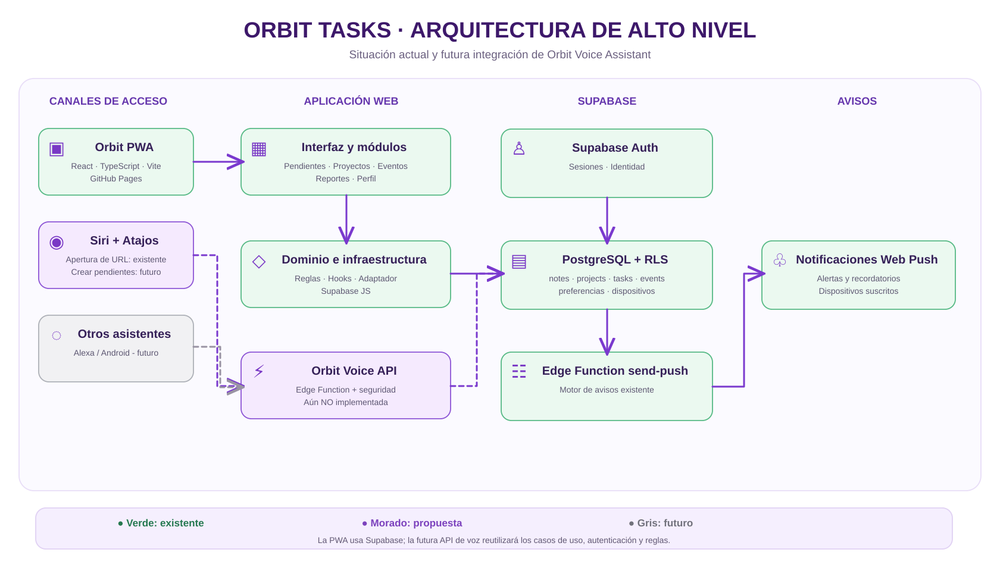
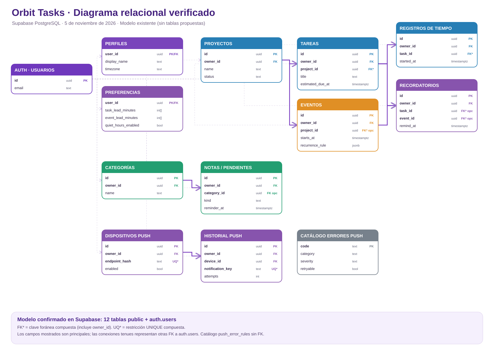
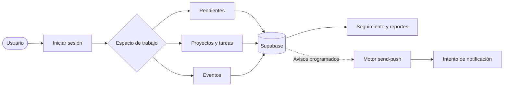

# Orbit Tasks

Aplicación web progresiva (PWA) para gestionar **pendientes personales, proyectos, tareas de proyecto, eventos, recordatorios y reportes**, construida con **React 19, TypeScript, Vite y Supabase**.

- Aplicación: https://davidduque29.github.io/orbit-tasks/
- Código: https://github.com/davidduque29/orbit-tasks
- Idioma principal: español (Colombia).

> Estado de documentación: 5 de noviembre de 2026. Este README describe funcionalidades identificadas en código y configuración; no equivale a una validación end-to-end de todos los escenarios. Las funciones futuras se distinguen expresamente.

## Funcionalidades existentes

| Módulo | Capacidades identificadas |
| --- | --- |
| Identidad y perfil | Registro/inicio de sesión mediante Supabase Auth, perfil y gestión de dispositivos. |
| Pendientes personales y notas | Crear, editar, completar y eliminar registros; búsquedas; recordatorios, recurrencia e historial de ocurrencias. Los pendientes residen en `notes` (`kind = pending`). |
| Proyectos | Alta y eliminación de proyectos, asociación con tareas, indicadores de progreso. |
| Tareas de proyecto | Tablero en lista/Kanban, filtros, prioridades, estados, vencimiento, resolución y avisos configurables. Las tareas residen en `tasks` y requieren proyecto. |
| Eventos | Agenda, creación/edición/eliminación, recordatorios y reglas de repetición. |
| Notificaciones | Preferencias, dispositivos Web Push, horarios de silencio, avisos de pendientes/tareas/eventos, registro de entregas y reintentos mediante `send-push`. |
| Informes | Indicadores de avance, cierres y tiempos de ciclo. |
| Entrada por voz | Dictado para el ingreso rápido de pendientes: Web Speech API en navegadores compatibles y dictado del teclado en iOS. |

La entrega de notificaciones depende de permisos del dispositivo, suscripción push y ejecución del programador; que exista el código no garantiza recepción en todos los navegadores o estados del teléfono.

### Diferencia entre entidades

- **Pendiente personal**: registro en `notes` con `kind = 'pending'`; no requiere proyecto y puede tener `reminder_at`.
- **Tarea de proyecto**: registro en `tasks`; requiere `project_id`, puede tener `estimated_due_at` y reglas de aviso.
- **Evento**: registro en `events`; tiene `starts_at`, puede asociarse a un proyecto y admite repetición.

Estas entidades **no son intercambiables**. Las futuras integraciones deben respetar sus casos de uso y validaciones.

## Arquitectura actual

```text
iPhone / Android / navegador
    |
    v
PWA React + TypeScript (GitHub Pages)
    |-- src/components/       Vistas y formularios
    |-- src/hooks/            Carga y sincronización
    |-- src/domain/           Modelos, reglas puras y validaciones
    |-- src/infrastructure/   Cliente y repositorio Supabase
    |
    v
Supabase Auth + PostgreSQL (RLS)
    |
    +-- Edge Function: send-push
    +-- Suscripciones Web Push y bitácora de entregas
```

Es una **PWA modular**, no un conjunto de microservicios independientes. El frontend consume Supabase; algunas reglas de aplicación todavía están dentro de componentes React, por ejemplo la creación de pendientes en `src/components/NotesBoard.tsx`. Se prevé extraer esos casos de uso para reutilizarlos desde canales adicionales.

### Modelo de datos e infraestructura

- Proyecto Supabase: `bwoqjsuohquqkpgssxcd` (región `sa-east-1`).
- Tablas relevantes: `profiles`, `projects`, `tasks`, `events`, `notes`, `note_categories`, `reminders`, `notification_preferences`, `device_subscriptions`, `push_delivery_log`, `time_entries`.
- La Edge Function `send-push` está desplegada; utiliza una credencial de programador y secretos del servidor. **No exponer** su token o la `service_role` en clientes públicos.
- Las políticas RLS de `notes`, `tasks` y `events` restringen operaciones por propietario. Se requiere seguir probando su aplicación en toda ruta nueva.
- El manifiesto PWA está en `public/manifest.webmanifest` con modo de presentación `standalone`.

## Diagramas de arquitectura y datos

### Arquitectura general de Orbit Tasks



La arquitectura actual está basada en una PWA con React y Supabase. La integración **Orbit Voice Assistant** se presenta como **propuesta**, no como funcionalidad desplegada. La futura API permitiría recibir instrucciones desde Siri sin duplicar reglas de negocio.

[Ver diagrama de arquitectura en SVG](docs/assets/orbit-arquitectura-general.svg)

### Modelo relacional de la base de datos



El diagrama se elaboró a partir de las tablas y restricciones verificadas en el proyecto Supabase de Orbit: **12 tablas del esquema `public` y `auth.users`**. Muestra columnas principales y relaciones de claves foráneas reales. Las claves compuestas —por ejemplo `(project_id, owner_id)`— se identifican con `FK*`. El gráfico no representa todas las columnas, índices ni reglas de negocio.

[Ver diagrama relacional en SVG](docs/assets/orbit-modelo-relacional-verificado.svg)

## Flujo funcional de Orbit Tasks



Al iniciar sesión, el usuario elige entre **Pendientes**, **Proyectos y tareas** o **Eventos**. Orbit valida los cambios y los guarda en Supabase, desde donde se consultan los datos para informes y seguimiento. Cuando existen avisos programados, el motor `send-push` revisa preferencias, horarios y dispositivos antes de intentar enviar una notificación; este proceso se ejecuta por separado de la acción de guardar.

**Documentación completa:** [Flujo funcional de alto nivel: componentes, procesos y notificaciones](docs/flujo-funcional-orbit.md).

## Instalación local

Se requiere **Node.js 20+** y acceso a un proyecto Supabase apropiado.

```bash
git clone https://github.com/davidduque29/orbit-tasks.git
cd orbit-tasks
npm install
cp .env.example .env
npm run dev
```

En `.env` configura `VITE_SUPABASE_URL` y `VITE_SUPABASE_PUBLISHABLE_KEY`. Usa solo claves publicables en variables `VITE_*`: Vite las incluye en el bundle del navegador. Nunca incluyas secretos, contraseñas ni `service_role` ahí.

En Supabase Auth configura las URL de redirección autorizadas de los entornos que utilices.

### Calidad y verificación

```bash
npm run typecheck
npm test
npm run build
```

Estos comandos verifican tipos, pruebas Vitest y compilación. No sustituyen pruebas de integración con Supabase, RLS, Web Push o E2E en dispositivos. Para cada cambio debe verificarse también la publicación de GitHub Pages.

## Seguridad y buenas prácticas

- Validar y autorizar **en servidor** cada operación; las validaciones de frontend son solo una primera capa.
- Aplicar RLS por propietario y comprobar que los identificadores de proyecto, nota, tarea y evento pertenecen al usuario autenticado.
- Mantener secretos de envío push, claves de terceros y credenciales de servicio fuera del repositorio y del navegador.
- Evitar duplicados, registrar errores sin exponer datos sensibles y cubrir fechas/zonas horarias.
- Priorizar bajo acoplamiento, alta cohesión, SOLID, DRY, KISS, nombres expresivos y pruebas.
- Completar pruebas de integración de RLS y de extremo a extremo antes de nuevas integraciones públicas.

## Próxima iniciativa: Orbit Voice Assistant (propuesta, NO implementada)

Se propone permitir crear pendientes mediante **Siri + Atajos** sin navegar por la PWA, usando dictado de texto, una API autenticada y los casos de uso existentes. En fases posteriores se ampliaría a eventos, proyectos e interpretación libre mediante IA.

- La prueba actual con Atajos **solo abre la URL de Orbit en Safari**; **no crea pendientes**.
- No existe todavía un endpoint de voz desplegado ni vinculación segura del atajo con la cuenta.
- La solución propuesta requiere refactorizar la creación de pendientes, definir autenticación/revocación, idempotencia y pruebas.

**Documento de diseño separado:** [Propuesta funcional y técnica de Orbit Voice Assistant](docs/orbit-voice-assistant-propuesta.md).

## Estado de documentación y límites

Este README sustituye una descripción inicial que marcaba push y PWA como pendientes aun cuando ya existen sus componentes. Aun así, hay que mantener la documentación y el inventario de arquitectura alineados con cada cambio validado. No se declara disponibilidad universal de notificaciones, despliegue nativo iOS/Android ni integración Siri para creación de registros hasta verificarlos.
