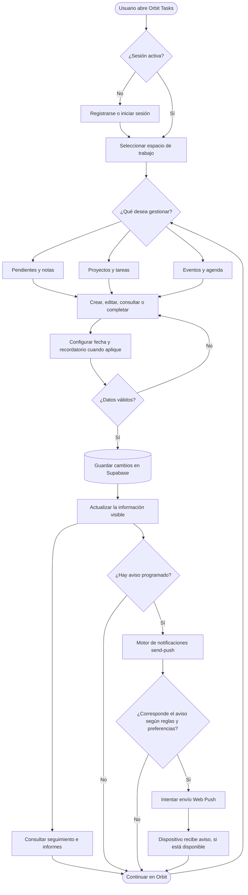
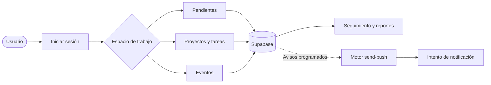

# Orbit Tasks — Flujo funcional de alto nivel

**Estado:** Documentación del proceso de usuario y de las interacciones principales de la aplicación existente.  
**Fecha:** 5 de noviembre de 2026.  
**Alcance:** Autenticación, Pendientes y Notas, Proyectos y Tareas, Eventos, persistencia, reportes y notificaciones. No representa la propuesta de Siri como funcionalidad implementada.

## 1. Diagrama de procesos

> **Lectura correcta:** la parte de notificaciones es una representación lógica, no una llamada síncrona después de guardar. La Edge Function `send-push` se ejecuta mediante su programador y busca los avisos debidos; puede no haber entrega si no existe suscripción, permiso o disponibilidad del proveedor.

## 2. Descripción general de cada componente y su flujo

### 2.1 Usuario y acceso a Orbit
El usuario abre Orbit desde un navegador o desde la PWA instalada. La aplicación consulta el estado de la sesión con Supabase Auth. Si no existe sesión, presenta las pantallas de registro, inicio de sesión o recuperación de contraseña. Cuando la identidad está validada, carga el espacio de trabajo correspondiente. La aplicación opera bajo la identidad del usuario y las políticas RLS de la base de datos delimitan la información accesible.

**Entrada:** solicitud de acceso / credenciales. **Salida:** sesión autenticada y acceso al espacio de trabajo.

### 2.2 Selección del espacio de trabajo
El usuario decide qué necesita gestionar. Los espacios funcionales relevantes son **Pendientes y Notas**, **Proyectos y Tareas** y **Eventos**. También puede consultar información de cuenta, dispositivos, preferencias de notificación y reportes. Los espacios comparten autenticación e infraestructura, pero sus entidades y reglas de negocio son diferentes.

**Entrada:** selección de menú. **Salida:** vista de trabajo apropiada.

### 2.3 Pendientes personales y notas
En el módulo de Pendientes se puede crear un registro sencillo, editarlo, buscarlo, marcarlo como finalizado y establecer fecha/hora de recordatorio. Un pendiente personal se almacena en `public.notes` con `kind = 'pending'`, mientras que las notas se identifican con `kind = 'note'`. El título y la programación se validan antes de guardarse. La recurrencia se almacena mediante `recurrence_rule` y se gestiona conforme a las reglas existentes.

El formulario permite entrada de texto; en dispositivos compatibles hay dictado por reconocimiento de voz y en iPhone se utiliza preferentemente el dictado del teclado. **Esto no equivale a crear pendientes mediante Siri**, capacidad que todavía está propuesta.

**Entrada:** texto, fecha/hora y recurrencia opcional. **Salida:** registro personal consultable en el módulo y posible recordatorio.

### 2.4 Proyectos y tareas
El usuario crea un proyecto y dentro de él registra tareas. Las tareas tienen título, prioridad, estado, fecha estimada de vencimiento y resolución. Se consultan mediante vistas de lista o Kanban y filtros. Las tareas se almacenan en `public.tasks` y requieren un `project_id` válido, perteneciente al mismo propietario. Los cambios de estado actualizan el seguimiento y los indicadores.

**Entrada:** proyecto y datos de la tarea. **Salida:** tarea persistida, progreso actualizado y posibles avisos por vencimiento.

### 2.5 Eventos y agenda
El usuario programa un evento con título, fecha y hora, puede editarlo o cancelarlo, y configurar recordatorios y recurrencia. El evento se guarda en `public.events` y puede estar relacionado con un proyecto de manera opcional. Las fechas se validan; la lógica de avisos consulta su programación y las preferencias del usuario.

**Entrada:** evento, fecha de inicio y opciones de repetición/aviso. **Salida:** evento visible en agenda con su programación.

### 2.6 Validaciones y reglas compartidas
Antes de guardar, la aplicación comprueba campos obligatorios, longitudes, fechas futuras cuando aplica y reglas de recordatorio. El dominio dispone de funciones reutilizables como `validateReminder` y validaciones de formularios. Algunas reglas de creación siguen en componentes de interfaz; no debe interpretarse que hoy existe un servicio centralizado de casos de uso para todos los módulos.

**Entrada:** información del formulario. **Salida:** aceptación del registro o mensaje de corrección, sin escritura cuando la validación falla.

### 2.7 Persistencia y sincronización
Los módulos utilizan el cliente Supabase para guardar y consultar datos en PostgreSQL. La base de datos aplica políticas RLS por propietario y relaciones de integridad. Tras operaciones exitosas la aplicación actualiza las vistas para reflejar los cambios. Esta persistencia sirve también como fuente para métricas, recurrencias y notificaciones.

**Entrada:** operación validada y autorizada. **Salida:** cambios persistidos y datos disponibles en la PWA.

### 2.8 Motor de notificaciones
La Edge Function `send-push`, ejecutada por su programador, consulta tareas, eventos y pendientes con avisos próximos. Comprueba las preferencias del usuario, los intervalos configurados, horarios de silencio, estado de los registros y dispositivos habilitados. Si corresponde el aviso, intenta enviarlo mediante Web Push. La tabla `push_delivery_log` conserva el estado de las entregas, evita duplicados por clave y soporta reintentos controlados. El envío no asegura que el sistema operativo presente siempre la notificación.

**Entrada:** registros programados, preferencias y suscripciones push. **Salida:** intento de aviso, estado de entrega y registro de resultados.

### 2.9 Reportes y seguimiento
El usuario consulta tableros e indicadores de tareas y proyectos, incluidos avance, cierres y duración de ciclos, conforme a los datos existentes. Los reportes leen la información persistida: no son una entidad de trabajo independiente ni tienen que producir notificaciones.

**Entrada:** datos del usuario en Supabase. **Salida:** indicadores y vistas de seguimiento.

### 2.10 Perfil, dispositivos y preferencias
El usuario administra información de perfil y opciones de notificaciones. Las preferencias regulan qué tipos de aviso se permiten y cuándo se suspenden; las suscripciones de dispositivos determinan los destinos disponibles para Web Push. Estos ajustes condicionan el comportamiento del motor de avisos sin modificar directamente las tareas, los eventos o las notas.

**Entrada:** configuración del usuario y autorizaciones del dispositivo. **Salida:** preferencias y suscripciones actualizadas.

## 3. Resumen para personas no técnicas

1. El usuario abre Orbit e inicia sesión.
2. Escoge si quiere organizar pendientes, trabajar con proyectos o programar eventos.
3. Registra o modifica información y configura avisos cuando los necesita.
4. Orbit valida y guarda los cambios; sus pantallas muestran los datos actualizados.
5. El sistema revisa periódicamente qué avisos corresponde enviar.
6. Cuando se cumplen las condiciones, intenta enviar el recordatorio al dispositivo.
7. El usuario puede consultar avances, historial e informes para hacer seguimiento.

## 4. Diagrama resumido (para README)

## 5. Aclaraciones y límites

- `notes` (pendientes personales), `tasks` (tareas de proyecto) y `events` (agenda) son entidades distintas y se gestionan mediante flujos propios.
- Los avisos de pendientes se apoyan en `reminder_at`; los de tareas y eventos se calculan a partir de sus fechas y reglas. La tabla `reminders` existe, pero el diagrama no afirma que cada aviso de los tres módulos deba insertarse allí.
- Recibir una notificación depende de permisos, suscripciones, horario, ejecución del programador y condiciones del dispositivo.
- Siri y Orbit Voice Assistant para **crear** pendientes siguen siendo una propuesta. Véase [propuesta de Orbit Voice Assistant](orbit-voice-assistant-propuesta.md).
- Este documento es un flujo funcional simplificado, no un diagrama de secuencia exhaustivo ni una certificación de pruebas E2E.
- Se actualizará junto con el inventario y seguimiento del proyecto cuando cambien procesos de producción.

## 6. Referencias de código y datos

- [App.tsx](../src/App.tsx): autenticación y composición de espacios.
- [NotesBoard.tsx](../src/components/NotesBoard.tsx): interacción de notas, pendientes y dictado.
- [TaskBoard.tsx](../src/components/TaskBoard.tsx): tareas, estados y filtros.
- [reminders.ts](../src/domain/reminders.ts): reglas reutilizables.
- [orbitRepository.ts](../src/infrastructure/orbitRepository.ts): operaciones de proyectos, tareas y eventos.
- [send-push](../supabase/functions/send-push/index.ts): evaluación y envío de avisos.
- [README](../README.md): visión general y diagramas.
