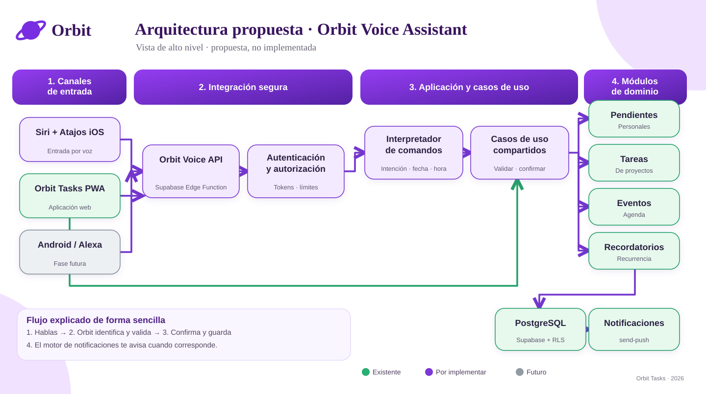

# Orbit Voice Assistant — Propuesta funcional y técnica

**Proyecto:** Orbit Tasks  
**Versión del documento:** 1.0 (propuesta, sin implementación)  
**Fecha:** 2026-11-05  
**Estado:** Diseño para revisión; ningún endpoint de creación por voz está desplegado.

## Diagrama de arquitectura de alto nivel



### ¿Cómo funciona? (explicación para cualquier persona)

La persona habla con Siri y le pide crear un recordatorio. Orbit recibe la instrucción de forma segura, entiende qué se necesita, muestra los datos para confirmarlos y guarda el pendiente. Cuando llegue el momento indicado, el sistema de notificaciones de Orbit podrá enviar el aviso.

**En una frase:** hablas → Orbit interpreta y confirma → guarda → te recuerda.

> Este diagrama muestra la **arquitectura propuesta**, no una función ya desplegada. En la primera etapa crearemos pendientes personales; eventos y tareas de proyectos se incorporarán después. La versión SVG del diagrama está en [docs/assets/orbit-voice-assistant-arquitectura.svg](assets/orbit-voice-assistant-arquitectura.svg).

## 1. Resumen ejecutivo

Orbit Voice Assistant permitirá registrar pendientes personales mediante comandos de voz ejecutados desde **Siri + Atajos de iOS**, sin requerir abrir o navegar en la PWA. Siri realizará el dictado; Orbit validará la identidad, interpretará la instrucción, confirmará la intención y persistirá el registro en Supabase. En etapas posteriores podrá admitir eventos, tareas de proyectos, lenguaje libre con IA y otros canales.

**Prueba ya realizada:** el atajo `Abrir Orbit` abre la URL pública en Safari; esto demuestra apertura por Siri, **no** creación de pendientes ni integración con el backend.

**Decisión de alcance MVP:** crear un `pending` en `notes`, con recordatorio opcional, sin duplicar la lógica de recurrencia, notificaciones ni permisos.

## 2. Situación actual y evidencia técnica

- Frontend: React 19, TypeScript, Vite, PWA en GitHub Pages.
- Persistencia y autenticación: Supabase Auth + PostgreSQL con políticas RLS por propietario.
- `src/components/NotesBoard.tsx`: contiene interfaz, dictado, validación y creación directa de pendientes mediante `supabase.from('notes').insert(...)`. Es un punto de refactorización.
- `src/domain/reminders.ts`: tipos y validación reutilizable de recordatorios y recurrencia.
- `src/infrastructure/orbitRepository.ts`: acceso a proyectos, tareas de proyecto y eventos; no cubre el CRUD de `notes`.
- `supabase/functions/send-push/index.ts`: servidor actual de avisos para tareas, eventos y pendientes, con controles de entregas repetidas y reintentos.
- `public/manifest.webmanifest`: PWA en modo `standalone`; al abrir la URL desde Atajos puede abrir Safari, no necesariamente la instalación PWA.
- Esquema: `notes` guarda pendientes personales (`kind='pending'`); `tasks` requiere `project_id`; `events` guarda `starts_at` y recurrencia.
- El proyecto Supabase de Orbit está activo en `sa-east-1`. La Edge Function `send-push` está activa. No se ha verificado aquí una API de creación por Siri ni su despliegue.

**Hallazgo de mantenimiento:** el README anterior describía push y PWA como pendientes. Se actualizó por separado. Se requieren pruebas E2E para afirmar compatibilidad y entrega de notificaciones en cada dispositivo.

## 3. Objetivo, usuarios y alcance

### Objetivo del MVP

Un usuario autenticado vincula un Atajo con su cuenta, dicta un pendiente en español, revisa título y fecha detectados, confirma la creación y recibe respuesta hablada. El pendiente aparece en el módulo Pendientes y utiliza el motor de recordatorios existente.

### Dentro del MVP

1. Vinculación y revocación de acceso de un atajo.
2. Dictado de texto desde Atajos; no se envía audio al servidor.
3. Interpretación de comandos estructurados o reglas deterministas para fechas y horas comunes.
4. Vista previa con confirmación explícita antes de guardar.
5. Creación de pendientes en `notes` respetando las validaciones existentes.
6. Respuesta hablada de éxito, rechazo o error.
7. Idempotencia y trazabilidad mínima de solicitudes.
8. Pruebas funcionales, negativas, de seguridad y de regresión.

### Fuera del MVP

- Despertador propio siempre activo («Oye Orbit»): una PWA no tiene activación permanente en segundo plano.
- Interpretación de fotografías/OCR, lotes y conversaciones largas.
- Crear/modificar/eliminar eventos o tareas de proyecto por voz.
- Acceso mediante Alexa/Android.
- Generación con IA obligatoria: opcional en fase posterior.
- App iOS nativa y App Intents: investigación futura.

## 4. Requerimientos funcionales

| ID | Requisito | Criterio de aceptación | Prioridad |
| --- | --- | --- | --- |
| RF-01 | Invocar mediante «Oye Siri, nuevo pendiente Orbit» | Se ejecuta el atajo sin dictar una URL | P0 |
| RF-02 | Capturar voz | «Dictar texto» devuelve transcripción o error claro | P0 |
| RF-03 | Identificar cuenta | Solo la cuenta vinculada puede crear su pendiente | P0 |
| RF-04 | Crear pendiente | Registro con `kind='pending'`, `owner_id` servidor, título válido | P0 |
| RF-05 | Fecha y hora | Resolver zona horaria del usuario y referencias no ambiguas | P0 |
| RF-06 | Recordatorio opcional | `reminder_at` futuro, compatible con `send-push` | P0 |
| RF-07 | Vista previa | Mostrar o leer los campos antes del POST final | P0 |
| RF-08 | Confirmación | Solo se escribe tras confirmación inequívoca | P0 |
| RF-09 | Respuesta | Atajo informa ID/éxito o error recuperable | P0 |
| RF-10 | Revocar vínculo | Credenciales revocadas dejan de crear registros | P0 |
| RF-11 | Evitar duplicados | Reintento con igual clave idempotente no crea otro pendiente | P0 |
| RF-12 | Recurrencia | Traducir y validar `RecurrenceRule` existente | P1 |
| RF-13 | Crear evento | Reutilizar caso de uso de `events` | P1 |
| RF-14 | Crear tarea de proyecto | Resolver y autorizar `project_id` | P1 |
| RF-15 | Interpretación conversacional | Preguntas por campos faltantes, IA opcional | P2 |
| RF-16 | Importar imagen y crear varios avisos | Confirmar cada uno antes de escritura | P2 |
| RF-17 | Otros asistentes | Android/Alexa por adaptadores | P2 |

## 5. Requerimientos no funcionales

| ID | Atributo | Criterio propuesto |
| --- | --- | --- |
| RNF-01 | Seguridad | HTTPS, tokens revocables y de mínimo privilegio, autorización por propietario |
| RNF-02 | Privacidad | No almacenar ni registrar audio en servidor; minimizar texto en logs |
| RNF-03 | Rendimiento | Objetivo inicial p95 < 2 s para POST estructurado sin contar dictado/red de voz; medir en pruebas |
| RNF-04 | Consistencia | Crear una vez por clave idempotente, incluso con reintentos simultáneos |
| RNF-05 | Disponibilidad | Errores recuperables; si hay fallo, no anunciar éxito |
| RNF-06 | Observabilidad | ID de correlación, etapa, código de error y latencia; sin secretos |
| RNF-07 | Portabilidad | Adaptadores de voz independientes de casos de uso |
| RNF-08 | Mantenibilidad | Alta cohesión, bajo acoplamiento, SOLID, KISS, DRY, convenciones TypeScript |
| RNF-09 | Calidad | Unitarias, integración RLS, E2E de atajo, seguridad y regresión Web Push |
| RNF-10 | Compatibilidad | iOS Atajos; preservar PWA y navegación actual |
| RNF-11 | Costos | Primero parsing determinista y Edge Function; IA bajo feature flag y límites |
| RNF-12 | Accesibilidad | Respuesta legible y hablada; confirmación manual como alternativa |

Los valores de rendimiento y disponibilidad son **metas de diseño**, no resultados medidos.

## 6. Arquitectura propuesta: modular, sin microservicios nuevos

```text
 Siri / iOS Atajos                       Orbit PWA React
     | Dictar texto                           | UI
     +-------------------+--------------------+
                         |
                 Orbit Voice API
               (Supabase Edge Function)
                 | auth / scope / rate
                 | parse / preview / confirm
                 v
               Aplicación (casos de uso)
                 |-- CreatePersonalPending
                 |-- (futuro) CreateEvent
                 |-- (futuro) CreateProjectTask
                 |-- ValidateReminderSchedule
                 |
               Puerto de persistencia
                         |
                 Adaptador Supabase
                         |
             PostgreSQL + RLS + Web Push
```

### Responsabilidades

- **Atajos iOS:** invocar, dictar, presentar confirmación, enviar peticiones HTTPS y leer respuestas.
- **Voice API:** autenticar, autorizar, limitar y validar requests; interpretar estructura y delegar a casos de uso; no es un segundo motor push.
- **Dominio/aplicación:** normalizar fechas, validar reglas, distinguir pendientes/tareas/eventos y ejecutar casos de uso.
- **Persistencia:** crear registros con titular verificado, aplicar restricciones de base e idempotencia.
- **Motor `send-push`:** conservar envío, horarios de silencio, preferencias, deduplicación de entregas y reintentos existentes.

### Refactorización mínima

Extraer de `NotesBoard.tsx` la validación y creación de pendientes a un caso de uso independiente de React. El navegador invocará ese caso de uso a través de su adaptador y la Edge Function dispondrá de una implementación servidor equivalente del contrato compartido. No importar componentes ni cliente browser dentro de Deno.

Propuesta de estructura (nombres orientativos, **no archivos implementados**):

```text
src/domain/personalPending.ts
src/application/createPersonalPending.ts
src/infrastructure/personalPendingRepository.ts
supabase/functions/orbit-voice/index.ts
supabase/functions/_shared/voice-contracts.ts
docs/orbit-voice-assistant-propuesta.md
```

Si se comparten reglas entre Vite y Deno, definir un paquete o módulo isomórfico sin APIs del navegador ni secretos.

## 7. API propuesta (contratos preliminares)

Rutas lógicas; las URLs reales se definirán al implementar bajo `/functions/v1/orbit-voice` o mediante un gateway.

### POST /voice/interpret

**Solicitud:**

```json
{
  "utterance": "Recuérdame pagar la pensión mañana a las 8 de la mañana",
  "timezone": "America/Bogota",
  "requestId": "uuid-generado-por-cliente"
}
```

**Respuesta sin escritura:**

```json
{
  "intent": "create_personal_pending",
  "draft": {
    "title": "Pagar la pensión",
    "reminderAt": "2026-11-06T08:00:00-05:00",
    "recurrenceRule": null
  },
  "requiresConfirmation": true,
  "warnings": []
}
```

Una fecha de ejemplo depende del contexto del día de ejecución; el servidor utilizará hora de referencia confiable y zona horaria validada.

### POST /voice/pending/confirm

**Solicitud:**

```json
{
  "draftId": "uuid-de-borrador-validado",
  "idempotencyKey": "uuid-estable-por-intento",
  "confirmed": true
}
```

**Respuesta:**

```json
{
  "status": "created",
  "recordType": "pending",
  "id": "uuid-creado",
  "message": "Pendiente creado correctamente"
}
```

No confiar en un borrador modificable libremente después de la confirmación. El servidor debe asociarlo a usuario, alcance, fecha de expiración y contenido, y volver a validar todos sus campos. Si se solicita crear sin fecha, debe definir explícitamente si no habrá recordatorio; **nunca inventar una hora**.

### Errores tipificados

- `400 INVALID_COMMAND`, `422 AMBIGUOUS_DATE`, `422 INVALID_REMINDER`.
- `401 UNAUTHORIZED`, `403 FORBIDDEN_SCOPE`.
- `409 REPLAY_CONFLICT` cuando misma clave idempotente lleva otro contenido.
- `429 RATE_LIMITED`, `503 SERVICE_UNAVAILABLE`.

La respuesta de reintento idéntico debe devolver el resultado inicial, no crear duplicados.

## 8. Diseño de seguridad

1. **Vinculación:** desde Orbit autenticado se autoriza un dispositivo/atajo; emisión de un secreto de alcance `pending:create`, con fecha de expiración, rotación y revocación. Preferir OAuth/PKCE o flujo de autorización específico cuando sea viable. No usar contraseña del usuario ni guardar `service_role` en Atajos.
2. **Almacenamiento:** no poner secretos permanentes en URLs, nombres de atajos ni capturas compartidas. El almacenamiento y recuperación del token en iOS debe validarse contra capacidades reales de Atajos; si no existe almacenamiento suficientemente seguro, emplear vínculo de corta duración con renovación autenticada o integración nativa.
3. **Validación:** resolver el usuario a partir del token verificado, nunca del `owner_id` enviado por cliente; comprobar propiedad del proyecto si se amplía a tareas.
4. **RLS:** ejecutar con contexto de usuario siempre que sea posible; si un servicio privilegiado es imprescindible, controles explícitos equivalentes y pruebas de autorización obligatorias.
5. **Protección:** límite por usuario/dispositivo/IP, límites de cuerpo, CORS restrictivo para clientes web, rate limiting y protección contra replay.
6. **Idempotencia:** clave única por usuario/operación con una transacción o restricción de BD que soporte concurrencia. No usar solamente comprobación previa en memoria.
7. **Auditoría:** registrar fecha, fuente `siri_shortcuts`, estado y correlación; redactar texto libre sensible y tokens.
8. **Prevención de abuso:** evitar que un modelo de IA decida autorización, proyecto, propietario o ejecute SQL arbitrario.

### Hallazgos actuales para seguimiento

- Las políticas RLS de `notes`, `tasks` y `events` restringen por propietario.
- El asesor Supabase advierte que **Leaked Password Protection** está desactivada: evaluar su habilitación.
- `push_delivery_log` tiene RLS sin políticas de acceso; podría ser intencional por uso exclusivo del backend y debe verificarse antes de modificar.

## 9. Flujo funcional de extremo a extremo

1. Usuario invoca «Oye Siri, nuevo pendiente Orbit».
2. El atajo ejecuta «Dictar texto».
3. Si transcripción vacía, vuelve a preguntar; no ejecuta POST de creación.
4. Envía `utterance`, zona horaria y `requestId` a interpretación autorizada.
5. Orbit identifica `create_personal_pending` y propone título y `reminderAt`.
6. Si hay ambigüedad (p. ej. «el próximo viernes» sin hora), pregunta antes de persistir.
7. Atajos lee el resumen; el usuario confirma o cancela.
8. Orbit valida nuevamente propietario, borrador y reglas; registra una vez.
9. Siri lee resultado confirmado por la API.
10. El pendiente aparece en `notes` y, si tiene hora de aviso, `send-push` puede procesarlo según preferencias/dispositivo.

### Reglas y bordes

- Resolver `mañana`, `pasado mañana` o `lunes` con fecha y zona local reales; evitar interpretar frases sin hora como alarmas a las 00:00.
- No crear un `task` cuando el usuario pide simplemente un pendiente.
- Respetar máximo actual de título de pendiente (80 caracteres), reglas de `validateReminder` y valores permitidos de recurrencia.
- No programar recordatorios en el pasado; comunicar corrección necesaria.
- Distinción entre fecha de un evento y fecha de notificación.
- El atajo no garantiza ejecutar con teléfono bloqueado; Siri/iOS pueden exigir desbloqueo o interacción.

## 10. Pruebas y criterios de salida

### Unitarias

- Parser de fecha, ambigüedad, normalización de títulos, formatos, límites, recurrence rule.
- Idempotencia y errores previsibles de negocio.
- Separación de entidad `pending` vs `task` vs `event`.

### Integración

- Crear pendiente autenticado y comprobar campos en `notes`.
- Denegar acceso con token vencido/revocado, sin credenciales o con alcance insuficiente.
- Probar aislamiento entre dos cuentas y `owner_id` falsificado.
- Simular dos solicitudes concurrentes con mismo `idempotencyKey`.
- Confirmar que el motor de push detecta los registros creados, sin generar notificaciones duplicadas.

### E2E iOS

- «Oye Siri, nuevo pendiente Orbit» con dictado correcto.
- Cancelación, silencio, pérdida de red, cierre del teléfono, permiso denegado.
- Título con caracteres especiales, fecha relativa, zona horaria y día de cambio horario cuando aplique.
- Verificar registro en PWA e intento real de aviso según preferencias.

### Criterios de finalización MVP

- RF-01 a RF-11 satisfechos (RF-12 opcional si se acuerda ampliar alcance).
- Sin secretos expuestos; RLS/autorización probados.
- Pruebas unitarias, integración y E2E documentadas y superadas.
- Despliegue validado sin romper PWA ni `send-push`.
- Inventario, actividades, errores y pendientes actualizados sin duplicados.

## 11. Etapas y entregables

| Etapa | Entregable | Dependencia |
| --- | --- | --- |
| 0 | Auditoría de esquema, validadores, flujo del atajo y estado de CI | Acceso a repo/Supabase |
| 1 | Casos de uso refactorizados, contrato tipado y pruebas | Etapa 0 |
| 2 | Vinculación y revocación segura, rate limits, idempotencia | Etapa 1 |
| 3 | Edge Function de interpretación/confirmación, pruebas de integración | Etapa 2 |
| 4 | Atajo iOS y pruebas reales con usuario | Etapa 3 |
| 5 | Documentación y liberación controlada | Etapa 4 |
| 6 | Opcional: IA, eventos, proyectos, imágenes y otros asistentes | Validación del MVP |

### Backlog sugerido

- Épica: `Orbit Voice Assistant — Siri Shortcuts`.
- Historias: vincular atajo, dictar comando, interpretar, confirmar, persistir, respuesta hablada, revocar acceso.
- Tareas técnicas: extracción `CreatePersonalPending`, diseño auth, tabla de solicitudes idempotentes, Edge Function, contrato, pruebas y documentación.
- Defectos/riesgos: sesión de PWA no transferible automáticamente al atajo, permisos de iOS, interpretación de fechas, posible expiración de credenciales, duplicados en reintentos.

## 12. Decisiones pendientes (ADR)

| ADR | Propuesta recomendada | Pendiente de validar |
| --- | --- | --- |
| ADR-001 Canal inicial | Siri + Atajos sin app nativa | Prueba en iOS |
| ADR-002 Backend | Supabase Edge Function modular | Límites, permisos y latencia |
| ADR-003 Autenticación | Vinculación y token con alcance, expiración y revocación | Seguridad de almacenamiento iOS |
| ADR-004 Parsing | Primero determinista para comandos acotados | Cobertura real de frases |
| ADR-005 Inteligencia artificial | Incorporar después bajo feature flag | Costos, privacidad y calidad |
| ADR-006 Datos | Pendientes en `notes`, `tasks` reservado a proyectos | Alineación UX |
| ADR-007 Push | Reutilizar `send-push` existente | Pruebas de entrega |

## 13. Riesgos y mitigaciones

| Riesgo | Impacto | Mitigación |
| --- | --- | --- |
| Exposición del token del atajo | Escrituras no autorizadas | Alcances mínimos, expiración, revocación, no guardar en enlaces |
| Fecha mal interpretada | Aviso incorrecto | Vista previa obligatoria y preguntas por ambigüedad |
| Atajos abre Safari | Fricción UX | No depender de apertura PWA para crear; solicitud HTTPS |
| Reintentos generan duplicados | Datos inconsistentes | Idempotencia transaccional |
| Componentes React concentran reglas | Acoplamiento | Extraer aplicación/dominio antes de integrar |
| Diferencia `notes` / `tasks` | Registro en módulo incorrecto | Clasificación y contrato explícitos |
| Push no entregado | Experiencia deficiente | Validar suscripción, permisos, cron, preferencias y observabilidad |
| Gastos IA | Costo creciente | Parser acotado y uso de IA con límites |

## 14. Responsabilidades operativas y control de cambios

- Mantener GitHub como fuente de código, contratos y documentación.
- Registrar implementación en GitHub Issues/Projects, con aceptación y pruebas.
- Reflejar cambios reales en Excel de **Inventario, Actividades, Errores y Pendientes**, sin repetir componentes o tareas. Esta propuesta documental **no significa** que la funcionalidad ya esté desarrollada.
- Cambios deben validarse en una rama/PR y luego desplegarse; registrar commit, fecha, evidencia de pruebas y versión.
- No marcar «terminado» sin comprobación real en iPhone y Supabase.

## 15. Referencias del repositorio

- [README principal](../README.md)
- [NotesBoard.tsx](../src/components/NotesBoard.tsx)
- [reminders.ts](../src/domain/reminders.ts)
- [orbitRepository.ts](../src/infrastructure/orbitRepository.ts)
- [send-push/index.ts](../supabase/functions/send-push/index.ts)
- [manifest.webmanifest](../public/manifest.webmanifest)

---

**Conclusión:** Orbit Voice Assistant es viable con el stack actual. La prioridad no es crear otro microservicio, sino construir una interfaz segura de entrada, desacoplar los casos de uso de Pendientes y reutilizar los mecanismos de persistencia, autenticación y notificaciones existentes.
